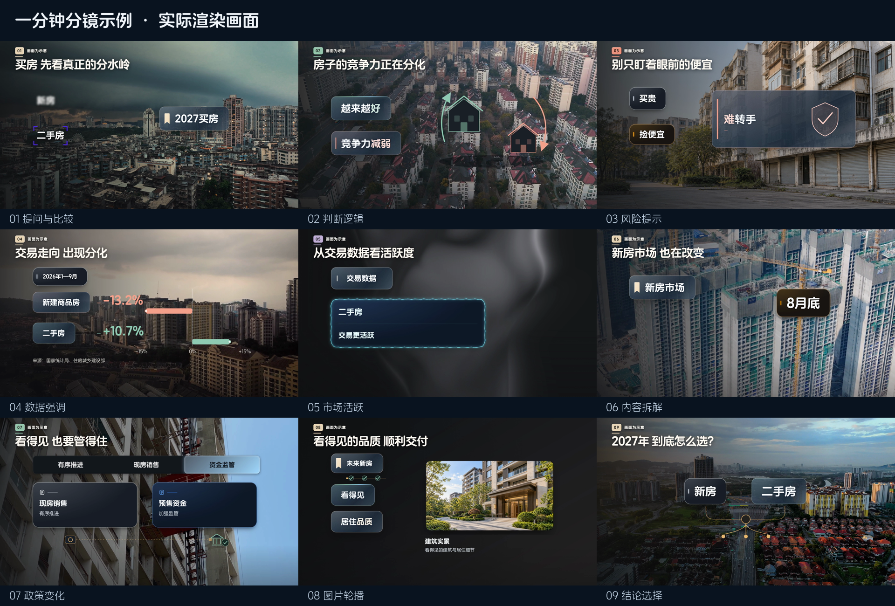
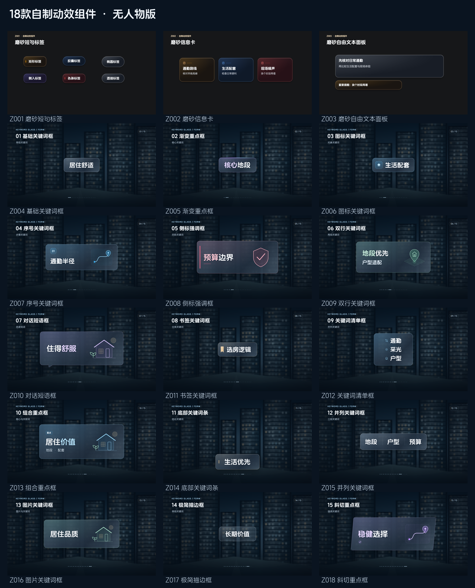

# 小滕分镜风格4.0版

学员可独立安装的Codex Skill：按文案与真实字幕时间码制作4.0深色磨砂分镜，结合两套本地组件库、图片轮播和转场，渲染后直接进入自带审片台。

[观看60秒示例](previews/学员示例.mp4) · [打开Skill](skills/xiaoteng-storyboard-style-4-0/SKILL.md) · [环境准备](skills/xiaoteng-storyboard-style-4-0/references/环境与启动.md)

## 已包含

- 完整4.0模板源码、固定参数、检查与渲染入口。
- 本地共享动效原始资料和截图，以及模板已有的帧驱动适配。
- 2个系列、18个自制动效组件，含源代码、入口、独立预览和系列公共素材。
- 非人物的示例图片、视频、磨砂材质和说明图形。
- 图片轮播的标签/说明分区布局，以及每个画面边界的轻量转场。
- 自带视频审片台，渲染检查通过后自动载入并打开，支持框选、时间点批注和汇总返修。只链接渲染目录的原视频，不复制或备份视频；会话仅保存当前源路径等必要信息。

## 安装与使用

Windows和macOS使用同一套Skill与工程。启动、字体准备、Python定位和审片视频路径均按本机系统处理；首次使用由Codex检查并准备缺失依赖。

把本仓库地址交给Codex，并说：“安装仓库中的skills/xiaoteng-storyboard-style-4-0。”

安装后提供文案、SRT或词元时间轴，并说：“调用小滕分镜风格4.0版，制作这一期分镜视频。”Codex按Skill创建独立学员工程，检查现有环境，准备必要依赖和字体，按本期内容选择组件、轮播图片与转场，再渲染并打开审片台。

[目录与组件调用](skills/xiaoteng-storyboard-style-4-0/references/目录与组件调用.md) · [转场与轮播](skills/xiaoteng-storyboard-style-4-0/references/转场与轮播.md)

## 文件管理

Skill位于skills目录，可与其他模板共存。每期源码、素材、规划、预览、成片分目录保存；共享动效库按三位编号管理，自制组件按S系列和全库唯一Z编号管理。新增系列从S003开始，新增组件从Z019继续。新期内容不覆盖组件库，更新Skill不覆盖学员已经编辑的项目。

字体、node_modules、浏览器、Python运行时和缓存不在仓库内打包，按明确依赖清单在学员本机准备。源代码和正式素材随包保存，不依赖作者电脑路径。共享原始条目保持实际完整性状态，未适配条目需完成当期适配后才能计入成片。

本包不包含人物组件或专属品牌画面；Skill名称按课程名称保留。素材与第三方原始条目的来源和权利说明见[NOTICE](NOTICE.md)。

## 验证范围

macOS已完成60秒示例、18项组件预览及审片台实际检查。Windows已检查启动逻辑、文件名、中文与空格路径、驱动器编码和Python定位，尚未在Windows设备完整渲染；首次使用需通过本机doctor与正式渲染检查。[查看验证记录](验证记录.json)。
